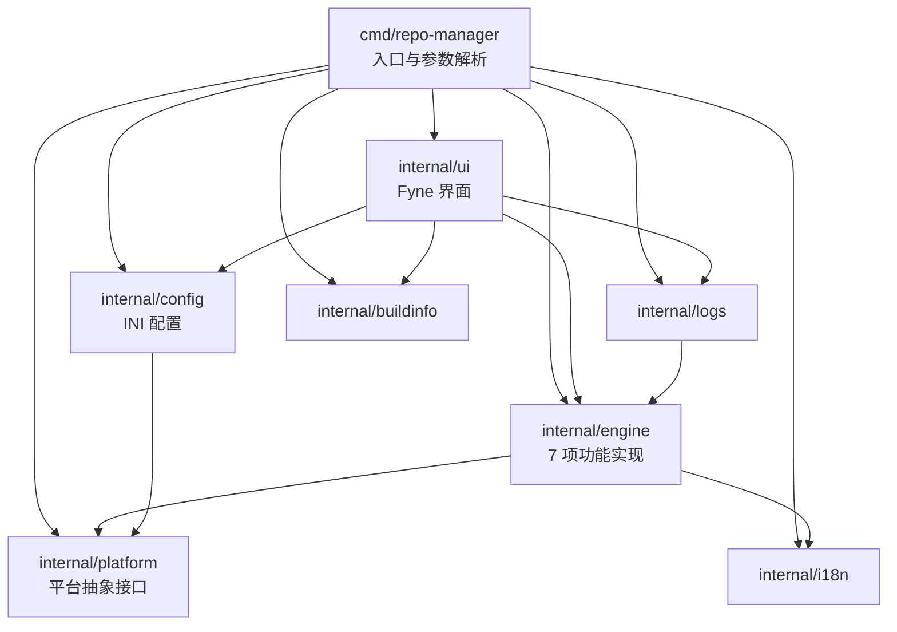
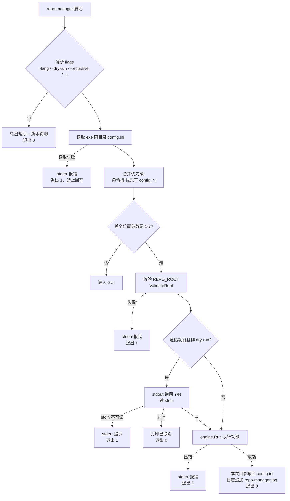
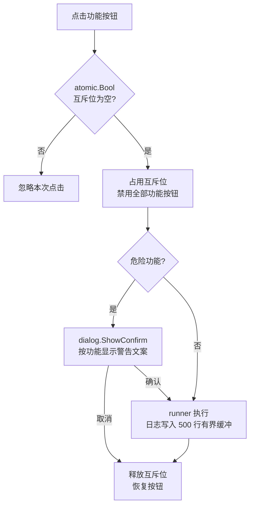

# Repo Manager 项目概述与架构设计 v2.3.7

> 本文回答「这是什么、为什么这样设计、如何运转」；功能行为契约见 [OPENSPEC.md](./OPENSPEC.md)，安装部署见 [INSTALL.md](./INSTALL.md)，CLI 接口契约见 [CLI-REFERENCE.md](./CLI-REFERENCE.md)，操作步骤见 [USER-GUIDE.md](./USER-GUIDE.md)。
> 与代码冲突时以代码为准，并按 [CONTRIBUTING.md §1.1](./CONTRIBUTING.md) 裁决同步本文。

## 目录

- [1. 项目概述](#1-项目概述)
- [2. 技术栈选型](#2-技术栈选型)
- [3. 架构设计](#3-架构设计)
- [4. 模块划分](#4-模块划分)
- [5. 业务流程图](#5-业务流程图)
- [6. 关键逻辑说明](#6-关键逻辑说明)
- [7. 评估与优化建议](#7-评估与优化建议)

---

## 1. 项目概述

### 1.1 背景

在同时维护多个 Node.js / 前端项目的开发机上，`node_modules` 与各类构建缓存（`.next`、`.vite`、`.turbo` 等）会占据数十 GB 磁盘；同一批全局依赖在每个项目里重复安装；Next.js 缓存删除后频繁自动重建难以阻止。这些问题跨平台（Windows / macOS / Linux）且分散在各项目目录中，手工清理效率低、易误删。

### 1.2 目标

Repo Manager 是一个**本地单文件桌面 / CLI 工具**，围绕 `REPO_ROOT`（项目根目录，多个项目的父目录）提供 7 项自动化能力：

| 功能 | 名称 | 危险操作（需确认） |
|------|------|:------------------:|
| 1 | 启用全局 node_modules（写 `NODE_PATH` + 各项目 `.npmrc` + 删除本地 `node_modules`） | ✅ |
| 2 | 重置 Node 配置（还原功能 1 的全部改动） | — |
| 3 | 清理 .next 缓存（删除并置同名隐藏文件阻止重建） | — |
| 4 | 恢复 Next.js 缓存（移除隐藏文件形态的 `.next`） | — |
| 5 | 安装全局依赖（5 组 `npm install -g`） | — |
| 6 | 清理所有项目缓存（白名单目录 + 锁文件） | ✅ |
| 7 | 清理 Vite / 构建缓存（白名单 + 可并入 `EXTRA_CLEAN_DIRS`） | ✅ |

行为契约（输入 / 输出 / 兼容性 / 已知限制）的唯一来源是 [OPENSPEC.md](./OPENSPEC.md) §3 / §4 / §7，本文不复述。

### 1.3 非目标

- 不做依赖版本管理、不替代包管理器（npm / yarn / pnpm 仍由用户自行使用）；
- 不提供网络服务、守护进程或远程访问——产品**没有任何 HTTP API**，详见 [CLI-REFERENCE.md §1](./CLI-REFERENCE.md)；
- 不做多用户 / 权限体系——访问控制完全依赖操作系统的文件权限（见 [USER-GUIDE.md §2](./USER-GUIDE.md)）。

---

## 2. 技术栈选型

| 层 | 选型 | 选型理由 |
|----|------|----------|
| 语言 | Go 1.25（`go.mod:3`） | 单文件静态编译、跨平台交叉编译成熟、标准库覆盖文件与进程操作 |
| GUI | Fyne v2.8.2（`go.mod:5`，唯一直接依赖） | 纯 Go 声明式 API、三平台一致渲染、自带暗色主题与对话框 |
| GUI 渲染依赖 | go-gl/gl + go-gl/glfw v3.4（间接依赖） | Fyne 默认标签经 OpenGL 渲染；Linux 下需 X11 + Wayland 开发库（见 [INSTALL.md §2](./INSTALL.md)） |
| 构建注入 | `-ldflags -X`（`scripts/build.ps1:47` / `build.sh:45-47`） | 版本号与 build 编号构建期注入，运行期稳定（[CONTRIBUTING.md §8.2](./CONTRIBUTING.md)） |
| 国际化 | 内置 `internal/i18n`（无第三方库） | 仅 3 种语言 `zh` / `zh-Hant` / `en`，词条量小，避免依赖膨胀 |
| 配置 | INI（`internal/config` 自实现） | 4 个键、保留注释与未知行、原子替换，无需解析库 |

**弃用说明**：仓库根 `src/`（Next.js 参考界面）自 v2.0.0 起弃用，仅作 UI 参考保留，不参与产品构建；`RepoCleaner.bat` / `lang.ini` 为 v1.x 遗留参考。

---

## 3. 架构设计

### 3.1 分层与依赖方向

依赖严格单向，无环：

**关键约束**：`engine` 只依赖 `platform.Platform` 接口（`internal/platform/platform.go:16-39`，10 个方法），**禁止直接调用 OS 命令或平台 API**；所有平台差异（隐藏属性、环境变量、默认根目录）收敛到 `platform_windows.go` / `platform_unix.go` 两个实现文件。

### 3.2 三种构建形态

| 构建方式 | 入口 | 说明 |
|----------|------|------|
| 默认（无标签） | `gui.go` → `ui.Run(cfg)` | 完整 Fyne GUI，需 C 工具链 + OpenGL |
| `-tags nogui` | `headless.go` → 打印提示 | 无 C 工具链环境的校验构建，GUI 代码不参与编译 |
| `-tags ci` | Fyne 提供的 software driver 标签（非本仓自定义） | 无需 C 工具链即可编译 `internal/ui`，用于 CI 类型检查 |

### 3.3 配置与持久化

`config.ini` 位于**可执行文件同目录**（便携式，`internal/config/config.go:29-35`），恰好 4 个键：`REPO_ROOT` / `LANG` / `RECURSIVE` / `EXTRA_CLEAN_DIRS`。保存采用「读旧 → 过滤 → 补写 → 写临时文件 → `os.Rename` 原子替换」（`config.go:89-157`），读旧失败即取消保存，防止损坏文件被覆盖。运行日志 `repo-manager.log` 同样落在 exe 同目录（`internal/logs/logs.go:18-24`）。

---

## 4. 模块划分

| 包 | 职责 | 关键文件 |
|----|------|----------|
| `cmd/repo-manager` | flag 解析、配置与语言装载、CLI 分发、GUI / Headless 分流、退出码 | `main.go` / `gui.go` / `headless.go` |
| `internal/engine` | 功能 1-7 的业务实现、危险操作判定（功能 1/6/7）、dry-run 分支 | `engine.go` / `clean.go` / `install.go` / `options.go` / `recursive.go` |
| `internal/config` | 4 键 INI 读写、原子保存、`EXTRA_CLEAN_DIRS` 解析与安全过滤 | `config.go` |
| `internal/platform` | 平台接口 10 方法 + Windows / Unix 实现、路径安全校验、项目目录枚举 | `platform.go` / `platform_windows.go` / `platform_unix.go` / `dirs.go` |
| `internal/ui` | Fyne 界面：整体重绘布局、执行互斥、暗色主题、GUI 日志缓冲（500 行有界）、`[n/m]` 进度 | `ui.go` / `runner.go` / `theme.go` / `output.go` / `logbuffer.go` |
| `internal/i18n` | 三语词条与归一化（`tw`/`zh-TW` → `zh-Hant`，其余回落 `zh`；繁中缺词条回退简中） | `i18n.go` / `log.go` |
| `internal/logs` | `FileLogger` 装饰器：互斥锁保护，带时间戳追加写文件并转发下游 Logger，打开失败仅降级不中断 | `logs.go` |
| `internal/buildinfo` | 版本唯一权威源 `Version`、`BuildID`、`Footer()`（`vX.Y.Z · build yymmddhhmm`） | `version.go` |

---

## 5. 业务流程图

### 5.1 CLI 启动与执行

### 5.2 GUI 执行互斥

### 5.3 功能 1 → 2 的生命周期

---

## 6. 关键逻辑说明

### 6.1 路径安全（删除类操作的防线）

所有清理目标只来自**枚举**，不接受任意路径：

1. `EXTRA_CLEAN_DIRS` 解析时逐项过 `platform.IsSafeCleanDirName`（`internal/platform/dirs.go:13-36`）：拒绝空值 / 首尾空白 / `.` / `..` / 长度超过 255 / 含 `/\:` / 绝对路径 / Windows 保留设备名（CON、PRN、AUX、NUL、COM1-9、LPT1-9）/ 控制字符，不合格项**直接丢弃**；
2. 功能 6 / 7 执行时**二次校验**，仍不合格的输出 `[警告] 已忽略不安全的自定义清理目录名`（`clean.go:109-119`）；
3. `ValidateRoot`（`platform.go:114-137`）拒绝文件系统根、不存在路径与非目录。

### 6.2 Next.js 缓存的「隐藏文件」机制（功能 3 → 4）

功能 3 删除 `.next` 目录后写**同名空文件**并设隐藏属性（Windows `attrib +h +s +r`，macOS `chflags hidden` + `chmod 444`，Linux 点前缀天然隐藏），阻止 Next.js 重建；功能 4 处理该形态时**必须先清隐藏属性再删除**（`clean.go:58`），否则静默失败。

### 6.3 项目目录枚举

`ListProjectDirs` 只枚举 `REPO_ROOT` 直接子目录；`ListProjectDirsDeep` 深度上限参数化（CLI / GUI 用 3 层），跳过 13 个依赖与产物目录（含 `.git`，`platform.go:42-46`），避免把依赖树误当项目。

### 6.4 dry-run 覆盖

`-dry-run` 对功能 1-7 全部生效：所有写环境变量 / 写文件 / 删除动作改输出 `[预演] 将...`（`install.go:25-28`、`log.go:89-93`），且跳过危险操作二次确认——预演模式是**零副作用**的。

### 6.5 版本与 build 编号

`Version` 常量是全仓唯一权威源（`buildinfo/version.go:13`）；`BuildID` 由构建脚本注入 10 位 `yymmddhhmm`，未注入时从 `debug.ReadBuildInfo` 的 `vcs.time` 推导。页脚 / CLI `-h` / 落地页统一格式 `vX.Y.Z · build yymmddhhmm`（[CONTRIBUTING.md §8.2](./CONTRIBUTING.md)）。

## 7. 评估与优化建议

> 本节为 **2026-11-25 评估快照**（基于 v2.3.7 代码实查）。除注明外均为**未实施建议**；实施排期统一登记于 [tasks.md](./tasks.md)，不在本文维护状态。

### 7.1 代码与架构

| 编号 | 问题背景 | 实施方案（技术选型与步骤） | 预期效果 | 优先级 |
|------|----------|------------------------------|----------|:------:|
| S1 | `repo-manager.log` 追加写无上限，长期驻留会无限增长（`logs.go` 无轮转） | 在 `internal/logs` 增加大小阈值（如 5 MB）：超限 `Rename` 为 `repo-manager.log.1`（仅留 1 份）再新建；单测覆盖切换边界 | 日志磁盘占用从无界收敛为约 10 MB 上限（可量化） | P2 |
| S2 | Windows 写用户环境变量依赖外部 `setx`（`platform_windows.go:55-68`），每次启动子进程开销大且超长值有截断风险 | 改用 `golang.org/x/sys/windows/registry` 直写 `HKCU\Environment`，删除分支同步移除 `reg delete`；保留 `setx` 降级路径 | 功能 1/2 少启动 2 个子进程（毫秒级 → 近零）；消除 1024 字符截断风险 | P2 |
| S3 | `EXTRA_CLEAN_DIRS` 仅允许单级目录名，无法指向「项目内子目录」（如 `apps/web/node_modules`） | 扩展为受限相对路径：逐段（每段 ≤255、拒绝 `.`/`..`/保留名）校验后 `filepath.Join` 拼接；默认关闭，需配置显式开启 | 支持嵌套清理场景；`..` 逐段拦截仍杜绝路径穿越 | P3 |
| S4 | GUI 无自动化测试（§9.3 依赖人工冒烟），回归依赖发版前手动验证 | 用 `fyne.io/fyne/v2/test`（软件驱动）编写组件级测试：互斥逻辑、按钮启停、日志缓冲 500 行边界；纳入 `ci.yml` | GUI 核心逻辑回归可自动化；CI 新增 1 个测试 job | P2 |

### 7.2 性能与体验

| 编号 | 问题背景 | 实施方案 | 预期效果 | 优先级 |
|------|----------|----------|----------|:------:|
| S5 | GUI 执行中无取消手段，长任务（功能 5 安装依赖）只能等结束 | `functionRunner` 携带 `context.Context`，`engine` 各子命令在步骤间检查取消；按钮改为「执行中可取消」 | 用户可中断长任务；取消响应 < 1 个子命令周期 | P2 |
| S6 | 深度枚举固定 3 层（`options.go:27-32`），深嵌套 monorepo 覆盖不足且不可调 | 增加 flag / 配置键 `SCAN_DEPTH`（默认 3，上限 8），GUI 高级设置同步 | 深层项目可被发现；枚举耗时随深度线性可控 | P3 |
| S7 | CLI 仅人类可读输出，脚本集成需解析中文文案 | 增加执行结果的结构化输出（`-json`，退出码不变） | 脚本 / CI 可靠集成；为未来 API 化铺垫 | P3 |
| S8 | 安装产物为 zip / tar.gz 便携包，无系统级安装器（缺少开始菜单 / 卸载入口） | 评估 `fyne-cross` 打包 `.msi`（Windows）与 `.dmg`（macOS），CI 矩阵追加安装包产物 | 降低非开发者用户安装门槛 | P3 |

### 7.3 文档与工程

| 编号 | 问题背景 | 实施方案 | 预期效果 | 优先级 |
|------|----------|----------|----------|:------:|
| S9 | 部分源码文件头注释版本落后于权威源（如 `main.go` 标 `v2.3.6`） | 按 [CONTRIBUTING.md §8.2](./CONTRIBUTING.md)：仅被改动文件的头注释随改动更新，禁止全仓刷写；下次触碰相关文件时顺带同步 | 头注释与权威源差异逐步收敛，不引入大 diff | P3 |

> 优先级含义：P1 = 阻断交付，P2 = 下一版本应处理，P3 = 择机排期。当前无 P1。

---

## 8. 文档索引

| 需求 | 文档 |
|------|------|
| 功能行为契约 | [OPENSPEC.md](./OPENSPEC.md) |
| 安装部署（依赖 / 配置 / 多环境 / 验证） | [INSTALL.md](./INSTALL.md) |
| CLI 接口契约（参数 / 退出码 / 配置键） | [CLI-REFERENCE.md](./CLI-REFERENCE.md) |
| 用户操作指南（GUI / CLI 步骤与流程） | [USER-GUIDE.md](./USER-GUIDE.md) |
| FAQ 与故障排除 | 根 [README.MD](../README.MD)「常见问题 FAQ」+ [TROUBLESHOOTING.md](./TROUBLESHOOTING.md) |
| 开发规范 / 版本 / 发布 | [CONTRIBUTING.md](./CONTRIBUTING.md) |
| UI 设计规范 | [DESIGN-SYSTEM.md](./DESIGN-SYSTEM.md) |
| 生产就绪与发布检查 | [PRODUCTION-READINESS.md](./PRODUCTION-READINESS.md) |
| 未完成任务排期 | [tasks.md](./tasks.md) |
