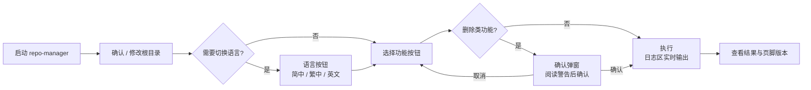
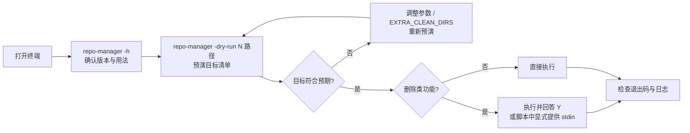

# Repo Manager 用户操作指南 v2.3.7

> 面向日常使用者。功能行为细则见 [OPENSPEC.md](./OPENSPEC.md)；参数速查见 [CLI-REFERENCE.md](./CLI-REFERENCE.md)；FAQ 见根 [README.MD](../README.MD)「常见问题 FAQ」，故障排除见 [TROUBLESHOOTING.md](./TROUBLESHOOTING.md)。

## 目录

- [1. 角色与权限说明](#1-角色与权限说明)
- [2. 安全须知](#2-安全须知)
- [3. GUI 操作指南](#3-gui-操作指南)
- [4. CLI 操作指南](#4-cli-操作指南)
- [5. 典型场景流程](#5-典型场景流程)
- [6. 遇到问题](#6-遇到问题)

---

## 1. 角色与权限说明

Repo Manager 是**单用户本地工具**：没有账号体系、没有内置角色或权限开关。所有「权限」都来自操作系统：

| 你拥有的 OS 权限 | 能做的操作 | 会被拒绝 / 失败的操作 |
|------------------|------------|------------------------|
| 对 `REPO_ROOT` 及其子项目可读写 | 全部 7 项功能 | — |
| 对某些项目目录只读 | 枚举、预演（`-dry-run`） | 删除类功能（1/3/4/6/7）报错或部分失败 |
| 可修改用户级环境变量 | 功能 1 / 2（`NODE_PATH`） | 受组策略管控的机器上 `setx` 可能失败 |
| 安装了 Node.js + npm | 功能 1 / 2 / 5 | 未安装 npm 时功能 1/5 报错（`npm` 不在 PATH） |

企业设备若由 IT 统一管控环境变量与文件权限，请先与 IT 确认；工具不会绕过任何 OS 权限限制。

## 2. 安全须知

1. **删除类功能是 1、6、7**：功能 1 会删除各项目本地 `node_modules`，功能 6/7 按白名单清缓存与锁文件；执行前必有确认（GUI 弹窗 / CLI 询问 `Y`）。
2. **先用预演**：任何删除类操作前先跑 `-dry-run`（CLI）确认目标清单；GUI 确认弹窗的警告文案按功能不同（[ARCHITECTURE.md §5.2](./ARCHITECTURE.md)）。
3. **白名单边界**：功能 6/7 只清理固定白名单目录（`node_modules`、`.next`、`.nuxt`、`dist`、`build`、`.vite`、`.turbo` 等）与锁文件；`EXTRA_CLEAN_DIRS` 仅接受安全的单级目录名，`..`、绝对路径、Windows 保留名一律被丢弃并告警。
4. 功能 3 的「阻止重建」通过隐藏文件实现，恢复用功能 4；不要手工删除该隐藏文件（直接用功能 4）。
5. 危险操作不可撤销——删除的目录不进回收站。

---

## 3. GUI 操作指南

分步说明：

1. **启动**：双击 `repo-manager`（无参数即 GUI）。
2. **根目录**：界面显示当前 `REPO_ROOT`；首次使用时确认它指向存放各项目的父目录（默认 Windows `E:\Github`，Unix `~/Github`）。
3. **语言**：语言按钮在简中 / 繁中 / 英文间切换，选择会持久化到 `config.ini`；执行日志同步切换。
4. **执行功能**：点击对应功能按钮；执行期间全部功能按钮禁用（互斥），日志区以 `[n/m]` 显示进度，日志缓冲保留最近 500 行。
5. **确认弹窗**：功能 1 / 6 / 7 弹出确认框，警告文案按功能不同；取消即返回，不做任何改动。
6. **版本查看**：版本号只出现在页脚，格式 `vX.Y.Z · build yymmddhhmm`。

> 无自动化 GUI 测试，发版前人工冒烟清单见 [CONTRIBUTING.md §9.3](./CONTRIBUTING.md)。

## 4. CLI 操作指南

要点：

- 预演永远先行：`-dry-run` 对全部功能零副作用；
- 退出码只有 `0`（成功 / 取消）与 `1`（失败），含义见 [CLI-REFERENCE.md §2](./CLI-REFERENCE.md)；
- 脚本集成时注意：非交互环境下危险操作的确认会因 stdin 不可读而**退出 1**（不静默取消）；
- `-lang` 会持久化；`RECURSIVE` / `-recursive` 控制是否扫描子目录（深度 3 层）。

## 5. 典型场景流程

| 场景 | 推荐流程 |
|------|----------|
| 释放磁盘：全局化 node_modules | 预演 `1` → 执行 `1` → 观察 npm 是否正常解析全局包；不满意则执行 `2` 还原 |
| Next.js 缓存反复重建 | 执行 `3`（清理 + 隐藏阻止重建）；需要构建缓存时执行 `4` 恢复 |
| 项目换技术栈后的大扫除 | 预演 `6` / `7` → 确认清单 → 执行；自定义目录用 `EXTRA_CLEAN_DIRS` 并入 `7` |
| 新机器配置全局依赖 | 执行 `5`（5 组 `npm install -g`，单组失败不影响其余，最后汇总报错） |
| 排查「刚才做了什么」 | 打开 exe 同目录 `repo-manager.log` 按时间戳查看 |

## 6. 遇到问题

- 使用类问题 → 根 [README.MD](../README.MD)「常见问题 FAQ」；
- 启动 / 构建 / 门禁失败 → [TROUBLESHOOTING.md](./TROUBLESHOOTING.md) 按症状定位；
- 仍未解决 → [.github/SUPPORT.md](../.github/SUPPORT.md)（报缺陷勿公开贴日志中的本机路径）。